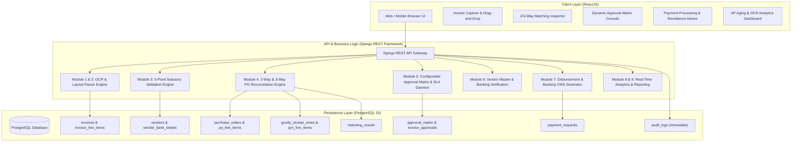

# Enterprise Accounts Payable (AP) Automation Software with OCR

[](https://react.dev/)
[](https://www.djangoproject.com/)
[](https://www.postgresql.org/)
[](LICENSE)
[](https://github.com/Abhishek-gadavi)

> **Recruitment Assignment Submission for:** Templegate Technologies & Services Pvt. Ltd.  
> **Candidate:** Abhishek Gadavi  
> **Submission Deadline:** 24th November 2026

---

## 📌 Project Overview

An end-to-end, enterprise-grade **Accounts Payable (AP) Automation Software** engineered to replace manual data entry, streamline multi-tier invoice approvals, perform automated **2-Way and 3-Way Purchase Order (PO) and Goods Receipt Note (GRN) matching**, enforce Indian GST statutory compliance, and orchestrate automated disbursement remittance.

Built strictly according to the mandatory technology stack:
* **Frontend:** ReactJS (Single Page Application with TailwindCSS)
* **Backend:** Django & Django REST Framework (Python 3.11)
* **Database:** PostgreSQL 14+ (UUID keys, ENUMs, triggers, composite indexes)

---

## 🏛️ System Architecture



---

## 🚀 The 9 Core Functional Modules

### 1. Invoice Capture Module
- **Multi-Format Ingestion:** Accepts PDF, Scanned TIFF, PNG, and JPG.
- **Channels:** Single file upload, Drag & Drop zone, Batch bulk ingestion, and automated email webhook ingestion simulation (`invoices@templegate.example.com`).

### 2. OCR & AI Extraction Module
- **Spatial Token Extraction:** Identifies invoice numbers, issue dates, due dates, billing parties, and payment terms.
- **Tabular Line-Item Extraction:** Parses line-by-line materials, HSN/SAC codes, quantities, unit prices, tax rates, and total amounts.
- **Confidence Scoring:** Assigns real-time accuracy percentages per token and cell.
- **Multi-Page Handling:** Accumulates line items across pages while suppressing duplicate sub-headers.

### 3. Invoice Validation Engine (5-Point Audit)
- **Mandatory Field Check:** Ensures no critical data is missing prior to processing.
- **Duplicate Invoice Detection:** Checks vendor + invoice number composite uniqueness.
- **GST / Tax Validation:** Verifies 15-character GSTIN regex, enforces intra-state (CGST+SGST) vs inter-state (IGST) supply logic.
- **Amount & Arithmetic Verification:** Validates `Subtotal + Taxes == Gross Total` within floating-point tolerance using arbitrary-precision `Decimal`.
- **Vendor Master Validation:** Confirms vendor active onboarding status and bank verification.

### 4. PO Matching Engine
- **2-Way Match:** PO vs Invoice (header amounts & authorized line rates).
- **3-Way Match:** PO vs Goods Receipt Note (GRN) vs Invoice (ensures billed quantity never exceeds warehouse accepted quantity).
- **Tolerance Limits:** Configurable price tolerance (default: `±2.0%`).
- **Discrepancy Breakdown:** Categorizes variances into price discrepancies, quantity discrepancies, or unauthorized line items.
- **Manager Override Protocol:** Authorizes managers to override discrepancies with audit notes.

### 5. Workflow & Approval Engine
- **Configurable Matrix:** Dynamic thresholds:
  - **Tier 1:** AP Clerk / Reviewer (Up to ₹25,000)
  - **Tier 2:** Finance Team Lead (₹25,000 - ₹1,00,000)
  - **Tier 3:** Finance Controller (₹1,00,000 - ₹5,00,000)
  - **Tier 4:** CFO / VP Finance (> ₹5,00,000, Parallel dual sign-off)
- **Role-Based Segregation:** Maker-checker segregation prevents unauthorized release.
- **SLA & Escalation:** Auto-flags invoices exceeding 24/48 hour turnaround SLAs.

### 6. Vendor Management Module
- **Vendor Master Directory:** Complete vendor profile, payment terms, and MSME priority status.
- **Bank Account Verification:** Stores account numbers, IFSC codes, and penny-drop verification badges.
- **Onboarding Workflow:** Lifecycle management (`Pending Onboarding` -> `Under Review` -> `Active` -> `Suspended`).

### 7. Payment Processing Module
- **Payment Request Generation:** Automatically scheduled upon final approval tier sign-off.
- **Bank Integration:** Generates standardized Banking CMS batch files (NEFT / RTGS / ACH).
- **Remittance Advice:** Generates digital Remittance Advice PDF vouchers with UTR transaction references.

### 8. Executive Dashboard
- **AP Aging Schedule:** Breakdown across 0-30 days, 31-60 days, 61-90 days, and 90+ days.
- **Operational KPIs:** Total volume, pending approvals queue, turnaround time (TAT: ~18.4 hrs), and average OCR accuracy (98.5%).
- **Vendor Spend Analytics:** Real-time visibility into top suppliers by cash outflow.

### 9. Compliance & Audit Reports
- **AP Aging Report:** Complete outstanding liabilities schedule.
- **Invoice Status Report:** Full lifecycle tracking from ingestion to settlement.
- **Exception & Discrepancy Log:** Pinpoints all failed validations and matching mismatches.
- **GST / Input Tax Credit (ITC) Report:** Statutory GSTR-2B reconciliation schedule.
- **Immutable Audit Trail:** Chronological log of all actions, users, and state transitions.

---

## 🛠️ Quick Start & Installation

### Option 1: One-Click Startup via Docker Compose (Recommended)

Make sure you have Docker installed, then run:

```bash
# Clone the repository
git clone https://github.com/Abhishek-gadavi/ap-automation-system.git
cd ap-automation-system

# Spin up PostgreSQL, Django Backend, and React Frontend
docker-compose up --build
```

Access the application:
* **Frontend Application:** [http://localhost:3000](http://localhost:3000)
* **Backend REST API:** [http://localhost:8000/api/v1/](http://localhost:8000/api/v1/)
* **Django Admin Portal:** [http://localhost:8000/admin/](http://localhost:8000/admin/)
* **PostgreSQL Server:** `localhost:5432` (User: `ap_user`, DB: `ap_automation_db`)

---

### Option 2: Manual Local Setup

#### 1. Database Setup (PostgreSQL)
```sql
CREATE DATABASE ap_automation_db;
CREATE USER ap_user WITH PASSWORD 'ap_secure_password_2026';
GRANT ALL PRIVILEGES ON DATABASE ap_automation_db TO ap_user;

\c ap_automation_db;
\i database/schema.sql
\i database/seed_data.sql
```

#### 2. Backend Setup (Django)
```bash
cd backend
python -m venv venv
# On Windows:
.\venv\Scripts\activate
# On Linux/macOS:
source venv/bin/activate

pip install -r requirements.txt
python manage.py migrate
python seed_data.py
python manage.py runserver 0.0.0.0:8000
```

#### 3. Frontend Setup (React)
```bash
cd frontend
npm install
npm run dev
```

---

## 📁 Repository Directory Structure

```text
ap-automation-system/
├── backend/                        # Django REST Framework application
│   ├── ap_core/                    # Project settings, routing, WSGI
│   ├── apps/
│   │   ├── vendors/                # Module 6: Vendor master & banking
│   │   ├── invoices/               # Module 1, 2, 3: Capture, OCR & validation
│   │   ├── matching/               # Module 4: 2-Way & 3-Way PO matching
│   │   ├── approvals/              # Module 5: Approval matrix & workflows
│   │   ├── payments/               # Module 7: Payment processing & advice
│   │   └── analytics/              # Module 8 & 9: Dashboards & reports
│   ├── manage.py
│   ├── requirements.txt
│   ├── Dockerfile
│   └── seed_data.py                # Database population script
├── frontend/                       # ReactJS application
│   ├── src/
│   │   ├── components/             # Reusable UI modules (Capture, Match, Matrix, etc.)
│   │   ├── mockData.js             # High-fidelity demo datasets
│   │   ├── App.jsx
│   │   └── main.jsx
│   ├── package.json
│   ├── vite.config.js
│   ├── index.html
│   └── Dockerfile
├── database/
│   ├── schema.sql                  # Full PostgreSQL DDL script
│   └── seed_data.sql               # Relational sample records
├── docs/
│   ├── DATABASE_SCHEMA.md          # Complete ER diagram and table dictionary
│   ├── CHALLENGES_AND_SOLUTIONS.md # Deep technical breakdown of engineering challenges
│   ├── DEMO_VIDEO_SCRIPT.md        # Minute-by-minute demo walkthrough guide
│   └── SUBMISSION_EMAIL.md         # Formatted reply template for Templegate
├── docker-compose.yml
├── .gitignore
└── README.md
```

---

## 📑 Core Documentation Deliverables

* 📊 **Database Schema:** [`docs/DATABASE_SCHEMA.md`](docs/DATABASE_SCHEMA.md) & [`database/schema.sql`](database/schema.sql)
* 💡 **Challenges and Solutions:** [`docs/CHALLENGES_AND_SOLUTIONS.md`](docs/CHALLENGES_AND_SOLUTIONS.md)
* 🎥 **Demo Video Recording Script:** [`docs/DEMO_VIDEO_SCRIPT.md`](docs/DEMO_VIDEO_SCRIPT.md)
* ✉️ **Email Submission Template:** [`docs/SUBMISSION_EMAIL.md`](docs/SUBMISSION_EMAIL.md)

---

## 👤 Author & Candidate Profile

* **Candidate:** Abhishek Gadavi
* **Email:** abhishekgadavi@gmail.com
* **GitHub:** [https://github.com/Abhishek-gadavi](https://github.com/Abhishek-gadavi)
* **Target Role:** Full Stack Software Engineer (React / Django / PostgreSQL)
* **Company:** Templegate Technologies & Services Pvt. Ltd.
