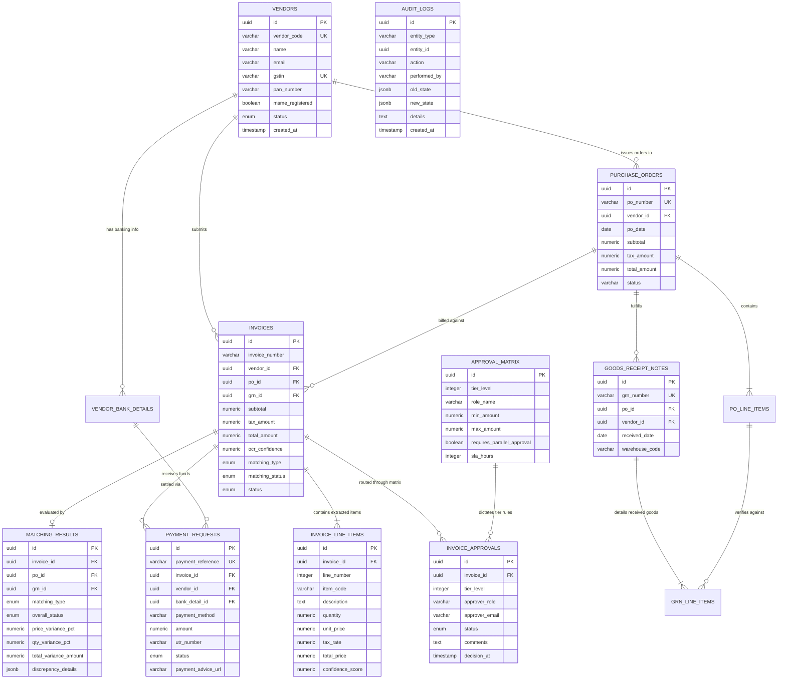

# PostgreSQL Database Schema & Architecture Design

**Candidate:** Abhishek Gadavi  
**Company:** Templegate Technologies & Services Pvt. Ltd.  
**Project:** Accounts Payable (AP) Automation Software with OCR  
**Database Stack:** PostgreSQL 14+ (Mandatory Technology Stack)

---

## 1. Entity-Relationship Diagram (Mermaid)

---

## 2. Table Structures & Field Definitions

### 2.1. `vendors` (Vendor Master)
Stores primary master records for approved and pending suppliers.
- `id` (UUID, Primary Key): Globally unique identifier.
- `vendor_code` (VARCHAR(32), Unique, Not Null): Internal company supplier code (e.g., `VEND-001`).
- `name` (VARCHAR(255), Not Null): Registered legal entity name.
- `email` (VARCHAR(255), Not Null): Billing notification email.
- `gstin` (VARCHAR(15), Unique, Not Null): Indian 15-character statutory GST identification number.
- `pan_number` (VARCHAR(10), Not Null): Income Tax Permanent Account Number.
- `msme_registered` (BOOLEAN): Flag for Micro, Small and Medium Enterprises Act compliance (mandates 45-day payment).
- `payment_terms_days` (INTEGER, Default: 30): Credit days agreed in vendor contract.
- `status` (ENUM): `PENDING_ONBOARDING`, `UNDER_REVIEW`, `ACTIVE`, `SUSPENDED`, `REJECTED`.

### 2.2. `vendor_bank_details` (Banking & Remittance)
Maintains verified beneficiary accounts for automated disbursements.
- `id` (UUID, PK)
- `vendor_id` (UUID, FK -> `vendors.id`)
- `bank_name` (VARCHAR(150), Not Null)
- `account_number` (VARCHAR(50), Not Null)
- `ifsc_code` (VARCHAR(20), Not Null): Indian Financial System Code.
- `is_primary` (BOOLEAN, Default: TRUE)
- `is_verified` (BOOLEAN, Default: FALSE): Requires penny-drop / automated verification before release.

### 2.3. `purchase_orders` & `po_line_items` (PO Master & Lines)
Authorized purchase orders committed by the procurement department.
- `po_number` (VARCHAR(64), Unique): Enterprise PO tracking number.
- `vendor_id` (UUID, FK -> `vendors.id`)
- `total_amount` (NUMERIC(15,2)): Gross contractual value.
- `status` (VARCHAR): `OPEN`, `PARTIALLY_BILLED`, `CLOSED`.
- Line items capture `item_code`, `quantity`, `unit_price`, `tax_rate`, and `total_price`.

### 2.4. `goods_receipt_notes` & `grn_line_items` (Warehouse Inward Deliveries)
Physical material receiving logs used in 3-way matching.
- `grn_number` (VARCHAR(64), Unique): Warehouse GRN docket number.
- `po_id` (UUID, FK -> `purchase_orders.id`)
- Line items record `quantity_received`, `quantity_accepted`, and `quantity_rejected` after quality check (QC).

### 2.5. `invoices` & `invoice_line_items` (OCR Extracted Invoices)
Core entity holding ingested documents, parsed fields, validation states, and confidence metrics.
- `invoice_number` (VARCHAR(100)): Extracted invoice number.
- `ocr_confidence` (NUMERIC(5,2)): Weighted layout & token confidence score (0-100%).
- `ocr_raw_payload` (JSONB): Raw OCR bounding boxes and text stream for forensic tracing.
- `validation_errors` (JSONB): Array of failed statutory checks (e.g. duplicate invoice, GST tax mismatch).
- `matching_type` (ENUM): `TWO_WAY`, `THREE_WAY`.
- `matching_status` (ENUM): `MATCHED_EXACT`, `MATCHED_WITHIN_TOLERANCE`, `DISCREPANCY_PRICE`, `DISCREPANCY_QTY`, `MANUALLY_OVERRIDDEN`.
- `status` (ENUM): `UPLOADED`, `PROCESSING_OCR`, `EXTRACTED`, `VALIDATION_FAILED`, `PENDING_MATCHING`, `MATCHING_FAILED`, `PENDING_APPROVAL`, `APPROVED`, `PAYMENT_SCHEDULED`, `PAID`.

### 2.6. `matching_results` (Reconciliation Engine Results)
Detailed reconciliation record storing computed variances:
- `price_variance_pct` (NUMERIC(6,2)): Difference between billed rate vs PO contracted unit price.
- `qty_variance_pct` (NUMERIC(6,2)): Billed quantity vs GRN accepted quantity.
- `discrepancy_details` (JSONB): Itemized list of specific item mismatches.
- `overridden_by` / `override_reason`: Audit stamp for manual manager overrides.

### 2.7. `approval_matrix` & `invoice_approvals` (Workflow Engine)
Implements threshold-based approval routing:
- Tier 1: AP Clerk (< ₹25,000)
- Tier 2: Finance Team Lead (₹25,000 - ₹1,00,000)
- Tier 3: Finance Controller (₹1,00,000 - ₹5,00,000)
- Tier 4: CFO / VP Finance (> ₹5,00,000, Parallel Dual Sign)
- Stores `sla_hours` (24-72 hours) and tracks `decision_at`, `comments`, and `escalated_to`.

### 2.8. `payment_requests` (Banking Disbursements)
- `payment_reference` (VARCHAR(64), Unique): Transaction tracking ID.
- `utr_number` (VARCHAR(100)): Unique Transaction Reference issued by the banking gateway upon NEFT/RTGS settlement.
- `payment_advice_url`: Endpoint for downloadable remittance advice PDF.

### 2.9. `audit_logs` (SOX & Regulatory Compliance)
Append-only immutable event journal tracking every action, user, IP address, old state, and new state.

---

## 3. Indexing & Optimization Strategy
1. **Composite Unique Index on `(vendor_id, invoice_number)`**: Guarantees zero duplicate invoices per supplier at the database level.
2. **B-Tree Indexes on Foreign Keys**: Speeds up JOIN operations between Invoices, Line Items, POs, and Approvals.
3. **Status & Date Indexing**: Optimized for dashboard queries (`status`, `invoice_date`, `created_at DESC`).
