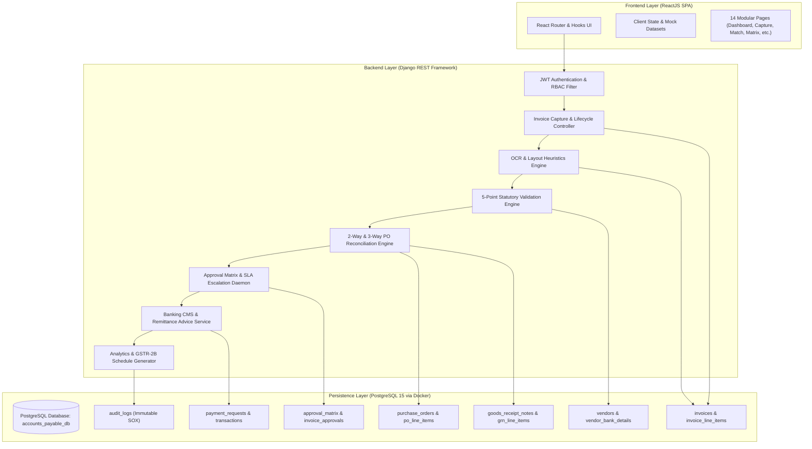

# Architecture & System Design Document

**System:** Accounts Payable (AP) Automation Software with OCR  
**Target Enterprise:** Templegate Technologies & Services Pvt. Ltd.  
**Stack:** ReactJS + Django REST Framework + PostgreSQL 15 (Docker)  
**Author:** Abhishek Gadavi  

---

## 1. High-Level Architectural Diagram

---

## 2. Core Architectural Principles

### 2.1. Decoupled Service Architecture
The backend is partitioned into discrete Django business applications (`accounts`, `vendors`, `invoices`, `matching`, `approvals`, `payments`, `notifications`, `analytics`), preventing monolithic tight coupling and ensuring each module can be maintained or scaled independently.

### 2.2. Deterministic State Machine
Invoice lifecycle transitions are governed strictly by state constraints:
`DRAFT` ➔ `UPLOADED` ➔ `PROCESSING_OCR` ➔ `EXTRACTED` ➔ `PENDING_MATCHING` ➔ `PENDING_APPROVAL` ➔ `APPROVED` ➔ `PAYMENT_SCHEDULED` ➔ `PAID`.  
Invoices cannot be scheduled for payment without traversing all preceding validation and approval checkpoints.

### 2.3. Mathematical Financial Integrity
All calculations involving Indian Rupee currency (subtotals, CGST, SGST, IGST, matching tolerances, gross totals) use arbitrary-precision Python `decimal.Decimal` and PostgreSQL `NUMERIC(15, 2)`, completely eliminating binary floating-point roundoff errors.

### 2.4. Containerized PostgreSQL Persistence
PostgreSQL 15 is configured with a named persistent Docker volume (`pgdata`), ensuring complete data durability across host reboots and container upgrades.
